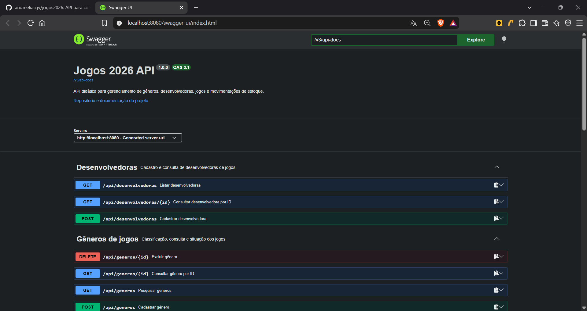

# Aula 09 — Documentação da API com OpenAPI

## Objetivo

Nesta aula, a API Jogos 2026 passou a publicar um contrato OpenAPI gerado a partir dos controllers e DTOs da aplicação. O contrato foi enriquecido com informações próprias do domínio, exemplos fictícios, respostas HTTP e schemas de erro.

O documento pode ser consumido por ferramentas em `/v3/api-docs` ou `/v3/api-docs.yaml`. O Swagger UI apresenta esse contrato como uma interface exploratória em `/swagger-ui.html`.

## OpenAPI, Springdoc e Swagger UI

OpenAPI é a especificação usada para descrever uma API HTTP. O documento gerado contém metadados, caminhos, operações, parâmetros, respostas e schemas reutilizáveis.

Springdoc examina a aplicação Spring MVC e gera o documento OpenAPI. Swagger UI lê esse documento e oferece uma interface visual para consulta e execução das operações. Portanto, Swagger UI não é a documentação em si: é uma das formas de visualizar e utilizar o contrato OpenAPI.

## Identificação do contrato

O bean `OpenApiConfig` define informações que identificam esta API:

| Informação | Valor |
|---|---|
| Título | `Jogos 2026 API` |
| Versão do contrato | `1.0.0` |
| Descrição | API para gêneros, desenvolvedoras, jogos e estoque |
| Documentação externa | Repositório do projeto |

A versão `1.0.0` identifica a versão comunicada do contrato. Ela não representa a versão do Java, do Spring Boot ou da especificação OpenAPI.

## Organização por recursos

As operações foram agrupadas por tags:

- **Desenvolvedoras** — cadastro e consulta das desenvolvedoras dos jogos;
- **Gêneros de jogos** — classificação, consulta e situação dos jogos;
- **Jogos** — cadastro, consulta e movimentação de estoque.

Cada operação possui resumo, descrição, parâmetros e resultados esperados. Os códigos de erro conhecidos referenciam o schema padronizado `ApiError`.

## Operações e evidências do contrato

| Operação | Sucesso | Erros documentados | Evidência no OpenAPI |
|---|---:|---|---|
| Cadastrar jogo | `201` | `400`, `404`, `409` | `POST /api/jogos` e schemas `JogoRequest` e `JogoResponse` |
| Consultar jogo por ID | `200` | `404` | `GET /api/jogos/{id}` e schema `ApiError` |
| Pesquisar jogos | `200` | `400` | `GET /api/jogos`, parâmetros de filtro, `page`, `size` e `sort` |
| Alterar jogo | `200` | `400`, `404` | `PUT /api/jogos/{id}` e schema `JogoAtualizacaoRequest` |
| Receber unidades | `200` | `400`, `404` | `POST /api/jogos/{id}/estoque/entradas` |
| Retirar unidades | `200` | `400`, `404` | `POST /api/jogos/{id}/estoque/saidas` |
| Excluir jogo | `204` | `404` | `DELETE /api/jogos/{id}` |
| Cadastrar gênero | `201` | `400`, `409` | `POST /api/generos` e schemas de gênero |
| Excluir gênero | `204` | `404`, `409` | `DELETE /api/generos/{id}` |

As anotações documentais não alteram o comportamento dos controllers. Declarar uma resposta `404`, por exemplo, informa o contrato ao consumidor, mas o código da aplicação continua responsável por produzir essa resposta no caso correto.

## Schemas e validação

Os DTOs de entrada e saída receberam descrições e exemplos fictícios por meio de `@Schema`. Foram documentados os contratos de desenvolvedora, gênero, jogo, alteração de status, movimentação de estoque, paginação e erro.

Bean Validation e OpenAPI possuem responsabilidades complementares. Anotações como `@NotBlank`, `@NotNull` e `@Positive` aplicam regras durante a execução. `@Schema` explica o significado do campo e fornece exemplos para quem consulta o contrato.

Os exemplos não contêm senhas, tokens, documentos pessoais nem dados reais.

## Filtros e paginação

A pesquisa de jogos documenta os filtros opcionais e os parâmetros de paginação. A resposta usa `PaginaResponse`, formada por:

- `conteudo`;
- `pagina`;
- `tamanho`;
- `totalElementos`;
- `totalPaginas`;
- `primeira`;
- `ultima`.

No laboratório manual, `GET /api/jogos?page=0&size=5&sort=titulo,asc` respondeu `200 OK` e apresentou a estrutura paginada.

## Erros padronizados

O schema `ApiError` documenta o corpo usado pela aplicação nos erros conhecidos:

| Campo | Significado |
|---|---|
| `timestamp` | instante em que o erro ocorreu |
| `status` | código HTTP numérico |
| `error` | nome do erro HTTP |
| `message` | explicação da falha |
| `path` | caminho da requisição |
| `fields` | erros de validação organizados por campo |

Documentar somente o código `404` não seria suficiente para um consumidor. A referência a `ApiError` também informa o formato do corpo que ele deve tratar.

## Evidência visual



A interface apresentou o título, a versão do contrato e as operações agrupadas em Desenvolvedoras, Gêneros de jogos e Jogos.

## Contrato exportado

O documento YAML foi exportado durante o laboratório para:

```text
target/jogos2026-openapi.yaml
```

O arquivo gerado possuía 30.265 bytes. Foram localizados nele `/api/jogos/{id}`, `JogoResponse`, `ApiError`, respostas `409` e os parâmetros `page`, `size` e `sort`.

O diretório `target` contém artefatos reproduzíveis da compilação e permanece fora do controle de versão. O contrato pode ser gerado novamente com a aplicação em execução:

```powershell
Invoke-WebRequest `
    -Uri http://localhost:8080/v3/api-docs.yaml `
    -OutFile target/jogos2026-openapi.yaml
```

## Publicação por ambiente

A documentação permanece disponível nos ambientes de desenvolvimento e teste. No perfil de produção, foi desabilitada explicitamente:

```properties
springdoc.api-docs.enabled=false
springdoc.swagger-ui.enabled=false
```

Essa decisão evita expor desnecessariamente a superfície da API enquanto não existe uma política específica de publicação e autenticação da documentação.

A desativação no profile `prod` foi verificada pela inspeção das propriedades, alternativa prevista pela aula quando não há um ambiente de produção configurado para a demonstração. Nenhuma credencial de produção foi adicionada ao projeto.

## Testes automatizados

`OpenApiDocumentationTest` acessa `/v3/api-docs` por `MockMvc` e verifica:

- versão 3 da especificação;
- título e versão do contrato;
- rotas essenciais de gêneros e jogos;
- resumo da consulta de jogo por ID;
- corpo documentado da resposta `404`;
- operações de entrada e saída de estoque;
- schemas `JogoResponse` e `ApiError`.

A suíte completa terminou com o seguinte resultado:

```text
Tests run: 53, Failures: 0, Errors: 0, Skipped: 0
BUILD SUCCESS
```

## Divergência identificada

Antes do enriquecimento manual, Springdoc conseguia descobrir rotas e tipos Java, mas não expressava adequadamente a intenção das operações, as regras de estoque, o significado dos filtros e os corpos dos erros.

A divergência foi corrigida com `@Tag`, `@Operation`, `@Parameter`, `@ApiResponse` e `@Schema`. Depois disso, o documento exportado e o teste automatizado confirmaram a presença das informações essenciais.

## Limite da geração automática

Uma documentação estruturalmente válida ainda pode ser insuficiente ou até descrever uma API mal projetada. Springdoc consegue inferir métodos, caminhos e tipos, mas não conhece sozinho a intenção do negócio nem garante que uma descrição esteja clara.

Por esse motivo, geração automática, teste estrutural e revisão humana são complementares. O teste protege elementos verificáveis do contrato; a inspeção do Swagger UI e do YAML avalia clareza, consistência e utilidade para o consumidor.

## Resultado

A API Jogos 2026 agora possui um contrato OpenAPI identificado, organizado por recursos e enriquecido com exemplos, paginação e erros. O contrato pode ser explorado pelo Swagger UI, exportado em formato processável e verificado automaticamente contra regressões.
