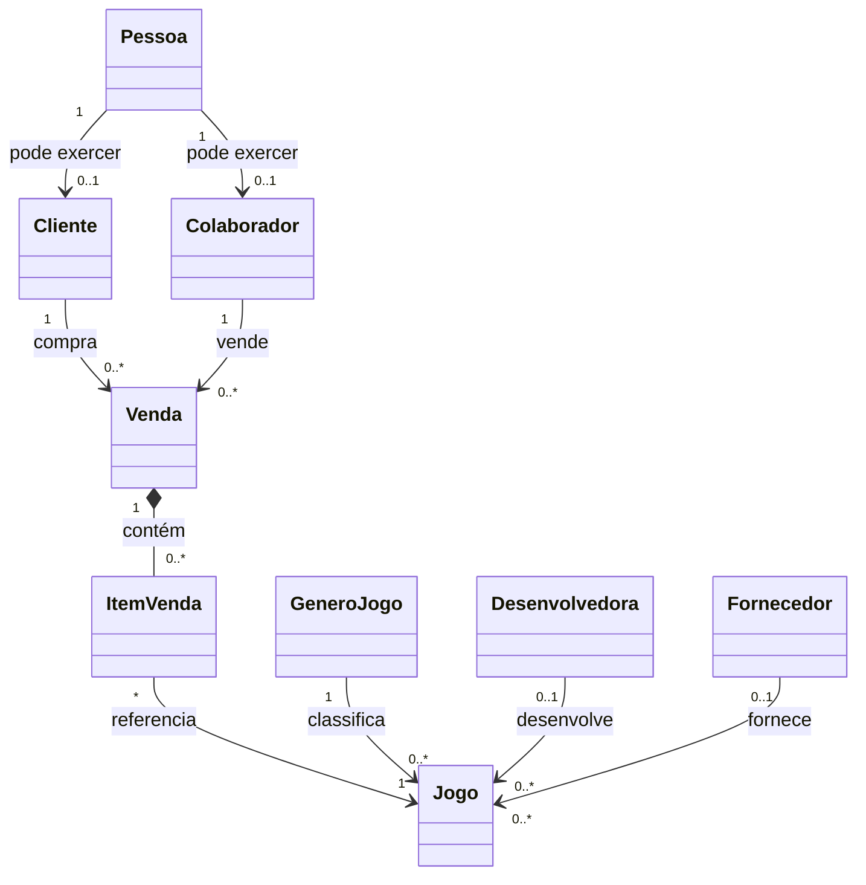

# Aula 10 — Pessoas, fornecedores e vendas

## Objetivo

Nesta aula, a API Jogos 2026 evoluiu de um catálogo com estoque para um domínio comercial. Foram acrescentados identidade de pessoas, papéis de cliente e colaborador, fornecedores e o ciclo de vendas de jogos.

O incremento preserva identidade, preço histórico e atomicidade: uma pessoa pode exercer mais de um papel, cada item registra o preço praticado e a finalização baixa todos os estoques na mesma transação.

## Modelo de domínio



`Pessoa` concentra nome, e-mail, CPF, data de cadastro e status. `Cliente` e `Colaborador` armazenam somente os dados específicos de cada papel.

## Composição em vez de herança

Não foi utilizada uma hierarquia como `Cliente extends Pessoa`. Cliente e colaborador não são tipos mutuamente exclusivos: a mesma pessoa pode comprar jogos e também possuir um vínculo profissional com a loja.

Com composição, cada papel possui uma associação `1:1` com `Pessoa`. Isso evita duplicar CPF e e-mail e permite adicionar ou remover papéis sem trocar a identidade central. Também evita escolher uma estratégia de herança JPA que criaria tabelas ou colunas inadequadas para papéis independentes.

`FuncaoColaborador` representa a função comercial — vendedor, estoquista, gerente ou administrativo. Ela não representa permissão de acesso. Autenticação e autorização permanecem fora do escopo desta aula.

## Validação de CPF e CNPJ

`DocumentoFiscal` calcula os dois dígitos verificadores de CPF e CNPJ e rejeita números formados por dígitos repetidos.

A regra é aplicada em duas fronteiras:

- o domínio impede construir `Pessoa` ou `Fornecedor` com documento inválido;
- Bean Validation usa `@CpfValido` e `@CnpjValido` para produzir respostas HTTP `400` por campo.

O banco verifica o formato numérico e a unicidade. O cálculo dos dígitos permanece na aplicação porque uma `CHECK` com o algoritmo completo duplicaria uma regra complexa e dificultaria sua manutenção.

A validação matemática não comprova que o documento foi emitido ou pertence à pessoa informada; ela confirma apenas sua consistência estrutural.

## Fornecedores e jogos

Fornecedor possui razão social, CNPJ único e status. Um jogo pode possuir fornecedor opcional, além de gênero e desenvolvedora.

A distinção utilizada é:

- desenvolvedora cria o jogo;
- fornecedor representa quem abastece a loja.

Os contratos de cadastro, alteração, consulta e pesquisa de jogos passaram a aceitar e devolver `fornecedorId` e a razão social associada.

## Venda e entidade associativa

Uma venda relaciona cliente e vendedor e possui os estados:

- `ABERTA`;
- `FINALIZADA`;
- `CANCELADA`.

A relação entre venda e jogo é muitos-para-muitos, mas possui dados próprios. Por isso, `ItemVenda` é uma entidade e não uma coleção simples de jogos.

Cada item guarda:

- jogo;
- quantidade inteira;
- preço unitário praticado;
- subtotal calculado.

O preço é capturado quando o item entra na venda. Alterações posteriores no preço atual do jogo não modificam o histórico comercial.

## Regras do ciclo de venda

Somente uma venda aberta pode receber ou remover itens, ser finalizada ou cancelada. Um jogo não pode aparecer duas vezes na mesma venda e as quantidades devem ser positivas.

Uma venda vazia não pode ser finalizada. Cliente e vendedor precisam estar ativos, e o colaborador deve exercer a função de vendedor ou gerente.

O cancelamento ocorre antes da baixa de estoque, portanto não exige estorno. Estorno de uma venda já finalizada permanece fora do escopo.

## Transação e rollback

`VendaService.finalizar` percorre os itens, valida jogos ativos, retira as unidades e muda o estado da venda dentro de um único método `@Transactional`.

Se qualquer item não possuir estoque suficiente, uma exceção interrompe o caso de uso. O PostgreSQL recebe rollback de todas as baixas anteriores e a venda continua aberta. Isso evita uma venda parcialmente processada.

O teste `VendaServiceTest.deveDesfazerTodasAsBaixasQuandoUmItemNaoTemEstoque` demonstra esse comportamento com dois jogos: o primeiro possui estoque, mas o segundo falha. Ao final, o saldo do primeiro permanece inalterado.

Controle de concorrência entre duas finalizações simultâneas será tratado em uma evolução posterior.

## Persistência

A migration incremental `005-dominio-comercial-vendas.yaml` possui 15 changesets e acrescenta:

- tabela `fornecedor` e associação opcional em `jogo`;
- tabela `pessoa` com CPF único e índice funcional para e-mail;
- tabelas `cliente` e `colaborador` com uma pessoa por papel;
- tabela `venda` com cliente, vendedor, data e status;
- tabela `item_venda` com jogo, quantidade e preço histórico;
- chaves estrangeiras, restrições de unicidade e `CHECK`s;
- rollbacks explícitos.

Com as migrations anteriores, o banco de testes registra 33 changesets. O Hibernate permanece configurado com `ddl-auto=validate` e apenas confere a correspondência entre entidades e esquema.

## Contrato HTTP

### Pessoas

| Método | Endpoint | Operação |
|---|---|---|
| `POST` | `/api/pessoas` | Cadastrar identidade |
| `GET` | `/api/pessoas/{id}` | Consultar identidade |
| `GET` | `/api/pessoas` | Pesquisar com filtros e paginação |
| `PUT` | `/api/pessoas/{id}` | Alterar dados editáveis |
| `PUT` | `/api/pessoas/{id}/status` | Ativar ou inativar |

### Clientes e colaboradores

| Método | Endpoint | Operação |
|---|---|---|
| `POST` | `/api/clientes` | Associar o papel de cliente |
| `GET` | `/api/clientes/{id}` | Consultar cliente |
| `GET` | `/api/clientes` | Pesquisar clientes |
| `PUT` | `/api/clientes/{id}` | Alterar telefone |
| `POST` | `/api/colaboradores` | Criar vínculo profissional |
| `GET` | `/api/colaboradores/{id}` | Consultar colaborador |
| `GET` | `/api/colaboradores` | Pesquisar colaboradores |
| `PUT` | `/api/colaboradores/{id}` | Alterar matrícula e função |

### Fornecedores e vendas

| Método | Endpoint | Operação |
|---|---|---|
| `POST` | `/api/fornecedores` | Cadastrar fornecedor com CNPJ |
| `GET` | `/api/fornecedores/{id}` | Consultar fornecedor |
| `GET` | `/api/fornecedores` | Listar fornecedores |
| `POST` | `/api/vendas` | Abrir venda |
| `GET` | `/api/vendas/{id}` | Consultar venda completa |
| `GET` | `/api/vendas` | Pesquisar resumos paginados |
| `POST` | `/api/vendas/{id}/itens` | Adicionar jogo e capturar preço |
| `DELETE` | `/api/vendas/{vendaId}/itens/{itemId}` | Remover item de venda aberta |
| `POST` | `/api/vendas/{id}/finalizacao` | Baixar estoque e finalizar |
| `POST` | `/api/vendas/{id}/cancelamento` | Cancelar venda aberta |

Finalização e cancelamento são comandos de negócio e usam `POST`. Eles não representam a substituição integral da venda. Repetir uma finalização não baixa novamente o estoque porque a segunda tentativa encontra uma venda que não está aberta.

## Filtros e carregamento

Pessoas, clientes, colaboradores e vendas utilizam `Specification` para combinar filtros opcionais no PostgreSQL. A ordenação é validada por listas explícitas de propriedades aceitas.

As consultas de clientes, colaboradores e vendas usam `EntityGraph` para carregar os relacionamentos necessários enquanto a transação está aberta. A pesquisa de vendas devolve resumos sem itens; a consulta por ID devolve a representação completa.

## OpenAPI

O contrato passou a incluir as tags Pessoas, Clientes, Colaboradores, Fornecedores e Vendas, além dos novos DTOs. `OpenApiDocumentationTest` verifica as rotas de papéis, inclusão de item, finalização e o schema `VendaResponse`.

## Testes automatizados

A suíte terminou com:

```text
Tests run: 66, Failures: 0, Errors: 0, Skipped: 0
BUILD SUCCESS
```

Os novos testes cobrem:

- dígitos verificadores de CPF e CNPJ;
- validação duplicada na entrada HTTP e no domínio;
- normalização da pessoa;
- fornecedor válido e inválido;
- preço histórico de item;
- estados da venda;
- venda vazia;
- baixa de estoque;
- rollback integral quando um item não possui saldo;
- migrations e contrato OpenAPI.

## Postman

A coleção [Jogos 2026 — Aula 10](Jogos-2026-Aula-10.postman_collection.json) contém 17 requisições em sequência. Ela gera documentos válidos e valores únicos, armazena identificadores e demonstra:

1. criação das duas pessoas e de seus papéis;
2. cadastro de fornecedor, gênero, desenvolvedora e jogo;
3. abertura e montagem da venda;
4. mudança do preço atual sem alterar o preço histórico;
5. finalização e baixa de duas unidades;
6. rejeição da tentativa de remover item após finalizar;
7. pesquisa paginada da venda criada.

Nenhuma credencial é armazenada na coleção.

O cenário foi executado no Postman Runner com uma iteração e apresentou:

```text
Tests: 17
Passed: 17
Failed: 0
Errors: 0
Duration: 3.203 s
Average response time: 71 ms
```

Além dos códigos HTTP de sucesso, as asserções confirmaram o preço histórico de `149.90`, o total de `299.80`, a redução do estoque de 10 para 8 e a rejeição da alteração de uma venda finalizada.

## Resultado

O projeto agora representa a operação comercial básica de uma loja de jogos. A modelagem separa identidade de papéis, preserva o histórico dos itens e coordena estado da venda e estoque em uma transação atômica, mantendo DTOs, OpenAPI, testes e migrações alinhados.
