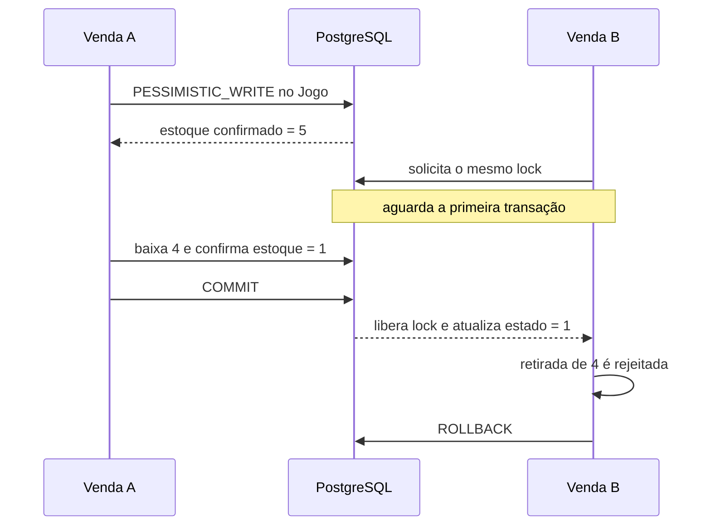

# Aula 11 — Concorrência de estoque, isolamento e locking

## Objetivo

Esta aula protegeu o estoque contra operações simultâneas. A transação da Aula 10 já garantia que a finalização de uma venda fosse integralmente confirmada ou desfeita, mas não impedia duas transações de lerem o mesmo saldo antes de gravarem suas baixas.

O recurso disputado no projeto é o estoque de cada `Jogo`. A invariante preservada é: a soma das retiradas confirmadas nunca pode superar a quantidade disponível.

## Condição de corrida

Sem bloqueio, duas vendas de quatro unidades poderiam ler simultaneamente um estoque igual a cinco:

```text
Tempo    Venda A                         Venda B
T1       lê estoque 5
T2                                       lê estoque 5
T3       valida 4 <= 5
T4                                       valida 4 <= 5
T5       calcula e grava 1
T6                                       calcula e grava 1
```

Cada transação parece válida isoladamente, mas oito unidades foram vendidas a partir de apenas cinco. Esse problema é uma atualização perdida: uma gravação sobrescreve o efeito da outra.

`@Transactional` sozinho garante atomicidade, mas o isolamento padrão `READ_COMMITTED` não transforma a leitura inicial em exclusão mútua. O PostgreSQL usa MVCC para permitir que leituras concorrentes observem versões confirmadas dos registros.

## Estratégia escolhida

Foi adotado locking pessimista com `LockModeType.PESSIMISTIC_WRITE`. Na finalização, cada jogo é atualizado e bloqueado por meio de:

```java
entityManager.refresh(jogo, LockModeType.PESSIMISTIC_WRITE);
```

O `refresh` é importante porque o jogo já foi carregado junto com a venda. A operação adquire o lock e substitui o estado da entidade gerenciada pelos valores confirmados mais recentes no banco antes da validação do saldo.

O locking pessimista foi escolhido porque o conflito representa a venda de estoque inexistente e deve ser impedido antes da gravação. Locking otimista com `@Version` seria uma alternativa adequada quando conflitos fossem raros e fosse aceitável detectar a colisão no momento do update, tratar a exceção e orientar uma nova tentativa.

## Fluxo concorrente protegido



O estado final correto é uma venda `FINALIZADA`, uma venda `ABERTA` e uma unidade em estoque. Não é necessário determinar qual venda vencerá; o requisito é que exista somente um resultado confirmado.

## Ordem e risco de deadlock

Uma venda pode conter vários jogos. Se duas transações bloqueassem os mesmos registros em ordens opostas, poderia surgir um ciclo de espera. Por isso, `VendaService.finalizar` cria uma lista ordenada pelo ID do jogo e adquire todos os locks em ordem crescente.

Essa ordenação reduz o risco de deadlock porque todas as finalizações seguem a mesma ordem global. Ela não elimina todos os deadlocks possíveis do sistema: novas operações que bloqueiem outros recursos em outra sequência deverão obedecer a uma política compatível. O PostgreSQL ainda pode detectar um ciclo e abortar uma das transações.

## Fronteira protegida

O mesmo lock foi aplicado a três caminhos que modificam a quantidade disponível:

- finalização de uma venda;
- entrada manual de unidades;
- saída manual de unidades.

Assim, uma movimentação manual não pode competir com uma venda usando um saldo desatualizado. Consultas e alterações de título, preço, gênero, desenvolvedora ou fornecedor continuam sem lock pessimista, pois a decisão desta aula protege especificamente a invariante do estoque.

As transações permanecem curtas: não há chamada HTTP externa, espera humana ou outro processamento demorado enquanto o banco mantém o lock.

## Teste concorrente

`VendaServiceTest.deveImpedirVendaAcimaDoEstoqueEmFinalizacoesConcorrentes` cria:

- um jogo com cinco unidades;
- duas vendas abertas com quatro unidades do mesmo jogo;
- duas tarefas iniciadas por um `CountDownLatch`;
- duas chamadas ao bean `VendaService`, cada uma em sua própria transação.

O teste aguarda os resultados com timeout de dez segundos e verifica:

- exatamente uma finalização com sucesso;
- exatamente uma rejeição por estoque insuficiente;
- exatamente uma venda finalizada;
- exatamente uma venda ainda aberta;
- estoque final igual a uma unidade.

Resultado isolado do teste de aplicação:

```text
Tests run: 3, Failures: 0, Errors: 0, Skipped: 0
BUILD SUCCESS
```

A suíte completa também foi executada no PostgreSQL:

```text
Tests run: 67, Failures: 0, Errors: 0, Skipped: 0
BUILD SUCCESS
```

O teste usa PostgreSQL real porque mocks não reproduzem MVCC, espera por lock, isolamento nem a existência de transações independentes.

## OpenAPI

O formato das requisições e respostas não mudou. As descrições das operações agora registram as garantias comportamentais:

- a finalização bloqueia os jogos em ordem determinística e baixa todos os estoques na mesma transação;
- as entradas e saídas manuais bloqueiam o jogo antes de alterar sua quantidade;
- repetir uma movimentação manual repete seu efeito, portanto ela não é idempotente.

## Liquibase

Não foi criado changelog nesta aula. O locking altera a maneira como a aplicação coordena transações, mas não cria ou modifica tabelas, colunas, índices, constraints ou dados de referência. O master permanece com os mesmos 33 changesets da Aula 10.

## Riscos que permanecem

- o lock pode aumentar o tempo de resposta quando houver muita disputa pelo mesmo jogo;
- transações longas ampliariam contenção e devem ser evitadas;
- deadlocks envolvendo futuras operações ainda precisam de ordem consistente e diagnóstico;
- retry automático não foi implementado, pois repetir comandos sem política de idempotência pode duplicar efeitos;
- o controle não substitui observabilidade futura de espera, timeout e deadlock.

## Resultado

O estoque agora é protegido no banco, funcionando mesmo que existam várias threads ou várias instâncias da aplicação. A solução diferencia atomicidade de isolamento, atualiza o estado antes da decisão, adquire locks em ordem determinística e comprova o resultado com duas transações concorrentes reais.
