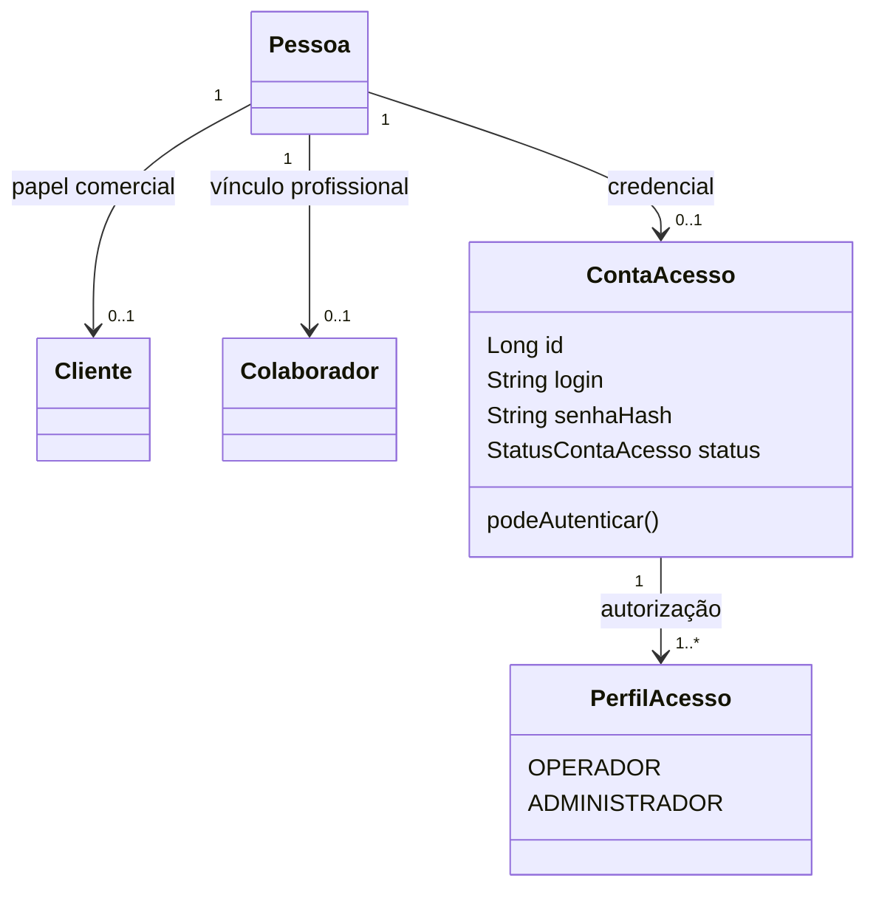
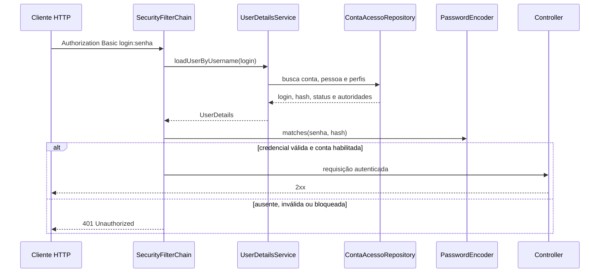

# Aula 12 — Autenticação, proteção de senhas e Spring Security

## Objetivo

A API passou a autenticar requisições com Spring Security e HTTP Basic. A credencial foi modelada separadamente da identidade civil e dos papéis comerciais: `Pessoa` responde quem alguém é, `Cliente` e `Colaborador` descrevem sua participação no negócio, e `ContaAcesso` controla como essa pessoa entra no sistema.

## Modelo



`FuncaoColaborador` não foi reutilizada como autoridade. Uma função como `VENDEDOR` descreve trabalho, enquanto `PerfilAcesso` descreve permissões de software. A separação evita conceder acesso administrativo apenas porque alguém possui determinada função profissional.

## Senhas e BCrypt

Senhas nunca são persistidas em texto aberto. O serviço usa o `DelegatingPasswordEncoder` do Spring:

```java
String senhaHash = passwordEncoder.encode(senhaAberta);
```

O valor armazenado começa com `{bcrypt}`. O prefixo identifica o algoritmo para o delegating encoder, e o restante contém custo, salt e hash. O salt faz com que duas codificações da mesma senha produzam valores diferentes.

Hash não é criptografia: não existe chave para recuperar a senha original. Na autenticação, `matches` aplica os parâmetros presentes no hash e compara o resultado. Por isso não se deve usar `encode(senha).equals(hash)`, pois um novo salt seria gerado.

As senhas aceitam entre 12 e 72 caracteres. O limite superior respeita a entrada efetivamente considerada pelo BCrypt. Nenhuma resposta, log, DTO de saída ou `toString()` contém senha ou hash.

## Conta e perfis

Uma conta:

- pertence a exatamente uma pessoa;
- possui login normalizado em minúsculas;
- começa com status `ATIVA`;
- recebe somente o perfil `OPERADOR` no cadastro público;
- autentica apenas se conta e pessoa estiverem ativas.

O request não aceita perfis. Isso impede que o cliente escolha `ADMINISTRADOR` no próprio cadastro.

## Persistência

A migration `006-contas-acesso.yaml` possui dois changesets:

1. cria `conta_acesso`, a relação única com pessoa, login normalizado único e `CHECK` de status;
2. cria `conta_acesso_perfil`, chave composta, FK com exclusão em cascata e `CHECK` dos perfis conhecidos.

O banco de testes passou de 33 para 35 changesets. O rollback remove primeiro a coleção dependente e depois a conta. O índice funcional `LOWER(BTRIM(login))` impede duplicidade por variação de caixa ou espaços externos.

## Fluxo de autenticação



`ContaAcessoUserDetailsService` converte cada perfil em uma autoridade `ROLE_<PERFIL>`. A mensagem para login inexistente é genérica para não revelar quais contas existem.

## Configuração HTTP

A API é `STATELESS`: cada requisição protegida apresenta sua credencial e nenhuma autenticação é guardada em sessão.

Rotas públicas:

- `GET /api/health`;
- OpenAPI e Swagger UI;
- `POST /api/pessoas`;
- `POST /api/contas-acesso`.

As duas operações de cadastro formam um bootstrap didático para banco vazio. Em produção, o provisionamento deveria exigir convite, validação de identidade, limitação de tentativas, auditoria ou intervenção administrativa.

CSRF foi desabilitado porque a API não usa cookie de autenticação enviado automaticamente pelo navegador. Se a aplicação migrar para autenticação baseada em cookie, essa decisão deverá ser revista.

HTTP Basic apenas codifica `login:senha` em Base64; não oferece sigilo. Em produção ele só pode ser usado sobre HTTPS/TLS.

## Endpoints de conta

| Método | Endpoint | Acesso | Operação |
|---|---|---|---|
| `POST` | `/api/contas-acesso` | público provisório | criar conta `OPERADOR` |
| `GET` | `/api/contas-acesso/me` | autenticado | consultar a própria conta |
| `PUT` | `/api/contas-acesso/me/senha` | autenticado | conferir senha atual e trocar o hash |

A alteração de senha exige a senha atual e rejeita a repetição da mesma senha. Depois da troca, a credencial anterior deixa de autenticar.

## OpenAPI

O contrato registra o security scheme global `basicAuth`. As operações públicas usam `@SecurityRequirements` vazio para retirar o cadeado apenas da documentação correspondente.

O Swagger UI apresenta o botão **Authorize**, permitindo informar credenciais fictícias para testar rotas protegidas. O cadeado descreve o contrato; a proteção efetiva continua nos filtros do Spring Security.

## Testes

`ContaAcessoServiceTest` verifica:

- senha aberta diferente do valor persistido;
- prefixo `{bcrypt}`;
- confirmação por `PasswordEncoder.matches`;
- invalidação da senha antiga depois da troca.

`ContaAcessoSecurityTest`, com os filtros ativos, verifica:

- health público com `200`;
- jogos anônimos com `401`;
- cadastro público sem senha ou hash na resposta;
- HTTP Basic correto com `200` em `/me`;
- senha incorreta com `401`;
- conta bloqueada com `401`.

Os testes antigos de controller usam `addFilters = false` para continuar isolando seus contratos. Isso não torna as rotas públicas: a política real é demonstrada pelo teste específico de segurança.

Resultado completo:

```text
Tests run: 75, Failures: 0, Errors: 0, Skipped: 0
BUILD SUCCESS
```

## Postman

A coleção [Jogos 2026 — Aula 12](Jogos-2026-Aula-12.postman_collection.json) contém nove requisições e somente credenciais fictícias. Ela gera CPF, e-mail e login únicos e demonstra:

1. health público;
2. criação pública de pessoa e conta;
3. ausência de senha e hash na resposta;
4. rejeição de rota protegida sem credencial;
5. autenticação correta em `/me`;
6. rejeição de senha incorreta;
7. alteração da senha;
8. rejeição da senha anterior;
9. autenticação com a nova senha.

As variáveis `authLogin`, `authOldPassword`, `authNewPassword` e `authPassword` pertencem somente à coleção didática. Nenhuma credencial local ou de produção foi exportada.

O cenário foi executado no Postman Runner com uma iteração e sem environment externo:

```text
Requests: 9
Tests: 13
Passed: 13
Failed: 0
Errors: 0
Duration: 2.798 s
Average response time: 171 ms
```

As barras verdes confirmaram tanto os acessos autorizados quanto as rejeições `401` esperadas. Nesse caso, receber `401` é sucesso do teste porque comprova que uma credencial ausente, incorreta ou antiga não atravessa a camada de segurança.

## Ameaças e limitações restantes

- HTTP Basic reapresenta a senha em toda requisição e exige TLS;
- o bootstrap público permite criação de contas e não é adequado para produção;
- ainda não existem limitação de tentativas, bloqueio progressivo ou auditoria de login;
- não há recuperação de senha, MFA, expiração ou revogação de sessões/tokens;
- os perfis já são carregados, mas regras finas por operação ainda serão evoluídas;
- CPF e outros dados sensíveis ainda exigem política de minimização e mascaramento.

## Resultado

O projeto agora diferencia identificação, autenticação e autorização. A senha é protegida por hash adaptativo com salt, as contas são persistidas separadamente dos papéis do negócio, as rotas exigem autenticação por padrão e o comportamento é comprovado no PostgreSQL e na camada de filtros do Spring Security.
