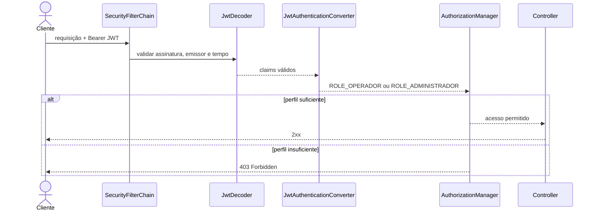

# Aula 14 — Autorização, perfis e controle de acesso

## Objetivo

A autenticação implementada na Aula 13 comprova quem apresentou o JWT. Nesta aula, a aplicação também decide o que essa identidade pode fazer. Os perfis persistidos no domínio são incluídos no token e convertidos para authorities do Spring Security, formando uma política RBAC simples e explícita.

## Autenticação e autorização

| Situação | Resultado |
|---|---:|
| token ausente, inválido ou expirado | `401 Unauthorized` |
| token válido sem o perfil necessário | `403 Forbidden` |
| token válido com o perfil necessário | operação executada |

O nome histórico de `401` pode confundir: ele indica que não existe autenticação válida. O `403` confirma que a identidade foi reconhecida, mas não possui autorização suficiente.

## Matriz de autorização

| Operação | Público | OPERADOR | ADMINISTRADOR |
|---|:---:|:---:|:---:|
| health e documentação em desenvolvimento | ✓ | ✓ | ✓ |
| login | ✓ | ✓ | ✓ |
| consultar e operar recursos do negócio | — | ✓ | ✓ |
| consultar a própria conta e alterar a própria senha | — | ✓ | ✓ |
| criar contas | — | — | ✓ |
| alterar perfis ou status de contas | — | — | ✓ |
| excluir recursos | — | — | ✓ |

O administrador inicial recebe `OPERADOR` e `ADMINISTRADOR`. Dessa forma, ele pode executar tanto as operações cotidianas quanto as administrativas. Uma conta criada pela API começa somente com `OPERADOR`, respeitando o princípio do menor privilégio.

## Perfis, claims e authorities

No domínio, os valores continuam sem prefixo:

```text
OPERADOR
ADMINISTRADOR
```

O JWT também armazena esses nomes no claim `perfis`. Depois que o token é validado, `JwtAuthenticationConverter` transforma os valores em:

```text
ROLE_OPERADOR
ROLE_ADMINISTRADOR
```

Essa conversão permite usar `hasRole("ADMINISTRADOR")` sem contaminar o enum ou o contrato JSON com uma convenção interna do Spring. O conversor não consulta o banco nem atualiza o token; ele apenas interpreta claims cuja assinatura já foi validada.

## Política HTTP e defesa em profundidade

As regras são avaliadas da mais específica para a mais geral:

1. health, OpenAPI, Swagger e login são públicos;
2. criação e gestão de contas exigem `ADMINISTRADOR`;
3. qualquer `DELETE /api/**` exige `ADMINISTRADOR`;
4. demais operações da API aceitam `OPERADOR` ou `ADMINISTRADOR`;
5. caminhos não classificados terminam em `denyAll()`.

Além da cadeia HTTP, os métodos administrativos do `ContaAcessoService` possuem `@PreAuthorize`. Essa defesa em profundidade preserva o caso de uso caso ele seja chamado futuramente por uma entrada diferente do controller. `@EnableMethodSecurity` torna essas anotações efetivas.

## Administração de contas

Foram acrescentadas as operações:

```text
PUT /api/contas-acesso/{id}/perfis
PUT /api/contas-acesso/{id}/status
```

A conta sempre deve possuir ao menos um perfil. O serviço também impede que um administrador remova de si mesmo o perfil administrativo ou bloqueie a própria conta. Além disso, o último administrador ativo não pode perder o perfil nem ser bloqueado. Essa verificação preserva uma invariante mínima, embora uma implantação distribuída ainda precisasse serializar alterações concorrentes com locking ou uma política externa.

## Administrador inicial

O cadastro público provisório das Aulas 12 e 13 foi encerrado. Quando não existe administrador ativo, um runner condicional pode criar a primeira conta a partir de variáveis presentes somente no ambiente. Pessoa, conta e perfis são persistidos na mesma transação, e apenas o hash BCrypt da senha chega ao banco.

O mecanismo fica desativado por padrão. O procedimento correto é:

1. configurar localmente as variáveis `INITIAL_ADMIN_*`;
2. ligar `INITIAL_ADMIN_ENABLED`;
3. iniciar uma vez e confirmar a criação;
4. interromper a aplicação;
5. desligar a flag;
6. iniciar novamente e administrar as demais contas pela API protegida.

Se já existir um administrador ativo, a execução é idempotente e não cria outra conta. Ainda assim, a flag deve ser desligada após o provisionamento.

## Fluxo de login

```mermaid
sequenceDiagram
    actor Cliente
    participant Controller as AutenticacaoController
    participant Manager as AuthenticationManager
    participant Details as UserDetailsService
    participant Banco as PostgreSQL
    participant Token as TokenService

    Cliente->>Controller: POST /api/autenticacao/login
    Controller->>Manager: login e senha
    Manager->>Details: carregar identidade
    Details->>Banco: consultar conta e perfis
    Banco-->>Manager: hash, status e ROLE_*
    Manager-->>Token: autenticação válida
    Token-->>Cliente: JWT com claim perfis
```

## Fluxo de autorização



## Ciclo de vida do token

Alterar um perfil no banco não modifica tokens já emitidos. Um token de operador continua sem autoridade administrativa até expirar, mesmo depois de a conta ser promovida. É necessário realizar novo login para receber claims atualizados. Da mesma forma, o bloqueio impede novos logins, mas um token antigo permanece válido até `exp` enquanto não houver revogação antecipada.

## Persistência, testes e Postman

Não foi criado changelog Liquibase porque a tabela de perfis, o valor `ADMINISTRADOR` e os status já existiam. A Aula 14 modifica política e comportamento, não o esquema relacional.

Os testes automatizados cobrem `401`, `403`, operações permitidas, conversão de perfis, proteção da própria conta, armazenamento exclusivo do hash e idempotência do administrador inicial. A suíte completa terminou com **82 testes, nenhuma falha e nenhum erro**. A coleção Postman demonstra a diferença entre operador e administrador, promove uma conta e comprova que somente um novo token recebe o perfil atualizado. Sua execução completa terminou com **12 requisições, 24 testes aprovados e nenhuma falha**.

Nenhuma senha administrativa, chave JWT ou token ativo faz parte dos arquivos versionados.
